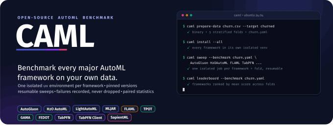
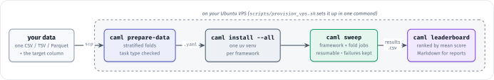
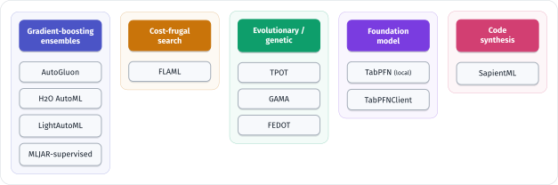
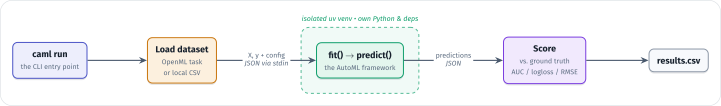
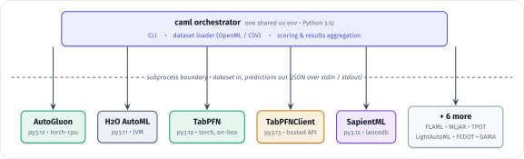

<p align="center">
  
</p>

<p align="center">
  <a href="LICENSE"></a>
  <a href="#frameworks"></a>
  <a href="pyproject.toml"></a>
  <a href="#run-it-on-a-vps"></a>
  <a href="https://github.com/astral-sh/uv"></a>
  <a href="https://github.com/A1i-Tabatabaei/CAML/actions/workflows/ci.yml"></a>
</p>

<p align="center">
  <a href="#quick-start"><b>Quick start</b></a> &nbsp;·&nbsp;
  <a href="#benchmark-your-own-data"><b>Your data</b></a> &nbsp;·&nbsp;
  <a href="#frameworks"><b>Frameworks</b></a> &nbsp;·&nbsp;
  <a href="#for-ai-agents"><b>AI agents</b></a> &nbsp;·&nbsp;
  <a href="docs/"><b>Docs</b></a> &nbsp;·&nbsp;
  <a href="#citing-caml"><b>Cite</b></a>
</p>

---

**CAML benchmarks the major open-source AutoML frameworks on any tabular
dataset, yours or the OpenML suites, behind one command line.** Each
framework is installed at a pinned, current version into its own isolated
[`uv`](https://github.com/astral-sh/uv) environment, so a framework that needs
`numpy<2` runs next to one that needs `numpy 2.x`. CAML then trains,
predicts, scores and ranks them the same way, and it records every failure
instead of dropping it.

It is a from-scratch rewrite inspired by OpenML's
[AutoML Benchmark](https://github.com/openml/automlbenchmark) (AMLB). CAML
keeps AMLB's core design: one sandbox per framework, with data crossing a
subprocess boundary. It replaces the install layer (stale pins, `deadsnakes`,
Docker) that keeps AMLB from installing on a current Ubuntu box.

<table>
<tr>
<td width="33%" valign="top">

**Every framework, one CLI**<br>
Install, run, sweep and compare 11 framework integrations with the same
commands and the same scoring.

</td>
<td width="33%" valign="top">

**Isolation that installs**<br>
One `uv` venv per framework, each with its own Python and exact pins. No
Docker, no PPAs, no dependency fights.

</td>
<td width="33%" valign="top">

**Your data in one command**<br>
`caml prepare-data` turns a CSV or Parquet file into stratified folds with
an explicit task type.

</td>
</tr>
<tr>
<td valign="top">

**Sweeps that survive**<br>
One isolated job per framework × task × fold. Resumable, shardable across
boxes, and every failure is classified.

</td>
<td valign="top">

**Honest statistics**<br>
A per-dataset leaderboard, and Wilcoxon / Friedman + Holm tests across
datasets, paired per task and never per fold.

</td>
<td valign="top">

**Ready for AI agents**<br>
A bundled <a href="skills/caml-benchmark/SKILL.md">agent skill</a> walks an AI agent, or a person, through a complete benchmark.

</td>
</tr>
</table>

## Quick start

CAML runs on an Ubuntu 24.04 server. Framework installs are large (AutoGluon
alone pulls about 170 packages), so use a VPS, not your laptop. From your
own machine:

```bash
git clone https://github.com/A1i-Tabatabaei/CAML.git && cd CAML
scripts/provision_vps.sh root@<your-server>   # apt baseline, uv, a caml user, the workspace, caml doctor
```

Then on the server, as the `caml` user:

```bash
ssh root@<your-server>
sudo -iu caml                                  # a shell as the unprivileged caml user
cd ~/caml-workspace/CAML
uv run caml install FLAML                      # one framework into its own venv
uv run caml run FLAML --benchmark test --constraint test   # 3 small OpenML tasks x 2 folds
uv run caml leaderboard --benchmark test
```

`caml install --all` installs the whole roster. [Run it on a VPS](#run-it-on-a-vps)
covers sizing and the manual route.

## Benchmark your own data

<p align="center">
  
</p>

```bash
scp churn.csv root@<your-server>:/tmp/            # then, on the server as the caml user:
uv run caml prepare-data /tmp/churn.csv --target churned --drop customer_id
uv run caml install --all
uv run caml sweep AutoGluon FLAML H2OAutoML LightAutoML MLJARSupervised TPOT GAMA FEDOT SapientML \
    --benchmark input/datasets/churn/churn.yaml --constraint quick
uv run caml leaderboard --benchmark input/datasets/churn/churn.yaml
```

- **`prepare-data`** reads CSV, TSV or Parquet. It writes 5 stratified folds
  by default (`--folds 1` gives a single holdout), drops rows with a missing
  target, and refuses classes too rare to appear in every fold. It always
  writes the task type explicitly: a 0/1 integer target is a classification
  problem, and without the explicit type CAML's loader would treat it as
  regression. It prints why it chose the type, so you can override it with
  `--type`.
- **`sweep`** runs each (framework, fold) as its own job. Re-running the same
  command resumes, and `--shard 1/2` / `--shard 2/2` split the matrix across
  two servers. Run it detached; see [docs/operations/sweeps.md](docs/operations/sweeps.md).
- **`quick`** gives each job 5 minutes on every core, which is right for a first
  screening. Re-run your top frameworks under `1h8c` before relying on the
  ranking. Wall-clock is about frameworks × folds × (budget + a few minutes).
- **`leaderboard`** ranks frameworks by mean score across folds and shows
  the spread, the folds that succeeded and the training time.
  `--markdown` prints a table ready for a report.

Real output, from CAML's own smoke-test history (OpenML task kc2,
2 folds, 60-second budget):

```text
kc2  (binary, constraint test, metric auc: higher is better)
rank  framework        auc mean  std     folds ok  train s (mean)
----  ---------------  --------  ------  --------  --------------
1     FLAML            0.9010    0.0360  2/2       60
2     MLJARSupervised  0.8880    0.0436  2/2       63
```

> [!IMPORTANT]
> **TabPFN and your data.** Local `TabPFN` runs fully on your server, but its
> weights need a free Prior Labs token, and on CPU it refuses more than 1,000
> training rows. `TabPFNClient` **uploads your data to Prior Labs' servers**,
> so leave it out of a sweep unless you are allowed to share the data. See
> [TabPFN setup](#tabpfn-setup).

## Frameworks

All 11 integrations solve tabular binary classification, multiclass
classification and regression.

<p align="center">
  
</p>

| Framework | CAML name | Approach | Pinned | License |
|---|---|---|---|---|
| [AutoGluon](docs/frameworks/autogluon.md) | `AutoGluon` | Multi-layer stacked ensembles; usually near the top of AMLB | 1.5.0 | Apache-2.0 |
| [H2O AutoML](docs/frameworks/h2o.md) | `H2OAutoML` | GBM/GLM/deep-learning models plus a stacked ensemble, on a JVM | 3.46.0.11 | Apache-2.0 |
| [LightAutoML](docs/frameworks/lightautoml.md) | `LightAutoML` | Gradient boosting and linear models, blended | 0.4.2 | Apache-2.0 |
| [MLJAR-supervised](docs/frameworks/mljarsupervised.md) | `MLJARSupervised` | Ensembles with automatic explanations and reports | 1.3.1 | MIT |
| [FLAML](docs/frameworks/flaml.md) | `FLAML` | Microsoft's fast, cost-frugal hyperparameter search | 2.6.0 | MIT |
| [TPOT](docs/frameworks/tpot.md) | `TPOT` | Genetic programming over scikit-learn pipelines | 1.1.0 | LGPL-3.0 |
| [GAMA](docs/frameworks/gama.md) | `GAMA` | Evolutionary search over pipelines | 23.0.0.post1 | Apache-2.0 |
| [FEDOT](docs/frameworks/fedot.md) | `FEDOT` | Evolutionary optimization of pipeline graphs | 0.7.5 | BSD-3-Clause |
| [TabPFN](docs/frameworks/tabpfn.md) | `TabPFN` | A pretrained transformer that predicts in one forward pass, on your server | 8.1.0 | Apache-2.0 code; non-commercial weights |
| [TabPFN client](docs/frameworks/tabpfn-client.md) | `TabPFNClient` | The same model through Prior Labs' hosted API (data leaves the server) | 0.3.3 | Apache-2.0 |
| [SapientML](docs/frameworks/sapientml.md) | `SapientML` | Generates pipeline source code from a corpus of human pipelines | 0.4.17 | Apache-2.0 |
| [NaiveAutoML](docs/frameworks/naiveautoml.md) | `NaiveAutoML` | *Skipped: a confirmed upstream bug fails every task* | 0.1.6 | MIT |

<details>
<summary><b>Which one should I try first?</b></summary>

| If you want… | Try | Why |
|---|---|---|
| The strongest general-purpose scores | AutoGluon | Deep stacked ensembles |
| A fast result from a small install | FLAML | Smallest dependency tree, quick search |
| Instant predictions on a small dataset, kept private | TabPFN | No search: one forward pass, on your server |
| Model explanations alongside the model | MLJAR-supervised | Writes explanation reports |
| A robust JVM workhorse | H2O AutoML | Battle-tested stacked ensembles |
| To compare evolutionary approaches | TPOT, GAMA, FEDOT | Three takes on pipeline search |
| Inspectable pipeline code | SapientML | Writes out the pipeline it built |

Or run them all: that's what CAML is for. On deliberately messy data
(missing values, odd label types), AutoGluon, FLAML, GAMA, H2O AutoML,
LightAutoML, MLJAR and TabPFNClient passed all 9 stress-test datasets. FEDOT,
SapientML and TPOT each failed on specific edge cases
([details](docs/operations/e2e-verification.md)).

</details>

Each framework's manifest (`frameworks/<Name>/framework.toml`) declares its
pin, Python range and system packages. Versions are exact-pinned and bumped
on purpose: `caml check-versions` lists newer releases, and
`caml install <name> --latest` is a one-off escape hatch.

## How it works

<p align="center">
  
</p>

The orchestrator owns data loading and scoring. A framework only ever sees a
train/test split and a config, and only hands back predictions, so every
framework is scored by the same code. The framework runs in its own venv, as
a subprocess:

<p align="center">
  
</p>

| | AMLB | CAML |
|---|---|---|
| Environments | stdlib `venv` + `pip`, Python from the `deadsnakes` PPA | `uv` for interpreters, venvs and installs |
| Framework setup | A hand-written `setup.sh` each, plus one large `frameworks.yaml` | One declarative `framework.toml` each, one shared installer |
| Versions | `"stable"` = `pip install -U` at install time | Exact pins, bumped on purpose |
| Runners | Docker, Singularity, AWS | One Ubuntu server, bare-metal venvs |

Design notes are in [docs/architecture/](docs/architecture/overview.md), and
the file-by-file provenance of the code adapted from AMLB is in
[NOTICE.md](NOTICE.md).

## Run it on a VPS

| | Minimum (smoke tests) | Recommended (full-roster sweeps) |
|---|---|---|
| CPU | 4 vCPU | 8 dedicated vCPU (x86_64) |
| RAM | 8 GB (a 4 GB swapfile is added below 8 GB) | 32 GB |
| Disk | 50 GB | 150–200 GB SSD |
| OS | Ubuntu 24.04, root or sudo over SSH | same; no GPU needed |

**One command, from your machine.** The script packages the repo with
`git archive`, pushes it over SSH, and needs no credentials on the server:

```bash
scripts/provision_vps.sh root@<host>      # idempotent; ends with a green caml doctor
scripts/sync_vps.sh root@<host>           # later: push code updates, keeps venvs and results
```

<p align="center">
  
</p>

<details>
<summary><b>Manual setup on the server instead</b></summary>

```bash
# as root
git clone https://github.com/A1i-Tabatabaei/CAML.git /tmp/CAML
bash /tmp/CAML/scripts/bootstrap_vps.sh          # apt baseline, uv, the caml user, swap
sudo -iu caml bash /tmp/CAML/scripts/setup_workspace.sh   # clones into ~/caml-workspace, uv sync, caml doctor
```

</details>

Before anything else on a new server, check that OpenML answers, because every
OpenML benchmark downloads its data from there:
`curl -m 20 https://www.openml.org/api/v1/json/task/3913 | head -c 200`.
Run long jobs detached so they survive your SSH session:
`setsid nohup uv run caml sweep ... > sweep.log 2>&1 < /dev/null & disown`.
When you're done, copy `output/` off the server and delete it; you're billed
while it exists. More in [the VPS runbook](docs/operations/vps-runbook.md)
and [GPU support](docs/operations/gpu.md) (CAML detects a GPU and uses it
for TabPFN, AutoGluon and LightAutoML).

## TabPFN setup

Both TabPFN variants need a free Prior Labs API key in `TABPFN_TOKEN`:

1. Register at [ux.priorlabs.ai](https://ux.priorlabs.ai), accept the
   licenses on the Licenses tab (the TabPFN-3 model license is required by the
   local `TabPFN`), and copy an API key.
2. On the server, as the `caml` user, store it without it reaching your shell
   history or the repo:

   ```bash
   read -rsp 'TabPFN token: ' t && printf 'export TABPFN_TOKEN=%q\n' "$t" > ~/.caml-secrets && unset t && chmod 600 ~/.caml-secrets; echo
   line='[ -f ~/.caml-secrets ] && . ~/.caml-secrets'; grep -qxF "$line" ~/.profile || echo "$line" >> ~/.profile
   ```

   It goes in `~/.profile`, not `~/.bashrc`: Ubuntu's `.bashrc` returns early
   for non-interactive shells such as `bash -lc '...'`.
3. `caml install TabPFN` (local) and/or `caml install TabPFNClient` (hosted).

| | `TabPFN` (local) | `TabPFNClient` (hosted) |
|---|---|---|
| Where it runs | On your server, CPU or GPU | Prior Labs' servers |
| Does your data leave the server? | No (the token only authorizes a one-time weight download) | **Yes, on every fit and predict** |
| Size limits | CPU: at most 1,000 training rows. A GPU lifts that. | Server-side limits and daily quotas |
| License | Code Apache-2.0; **weights non-commercial** | Apache-2.0 client; Prior Labs' terms of service |

Never commit the token. [docs/operations/tabpfn-access.md](docs/operations/tabpfn-access.md) has the details.

## Benchmarks, constraints and results

A **benchmark** chooses the datasets; a **constraint** chooses the budget per job.

| Benchmark | What |
|---|---|
| `test` | 3 small OpenML tasks (binary, multiclass, regression): "does it install and score?" |
| `validation` | 9 deliberately messy OpenML datasets: "is it robust?" |
| `pilot` | 9 tasks from the official AMLB suites, each chosen to exercise one risk |
| `openml/s/271`, `openml/s/269` | The full AMLB suites: 71 classification and 33 regression tasks |
| any `.yaml` path | Your own data, written by `caml prepare-data` |

| Constraint | Folds | Budget per job | Cores |
|---|---|---|---|
| `test` | 2 | 600 s (the `test` benchmark sets 60 s) | 4 |
| `quick` | 3 | 300 s | all |
| `pilot` | 2 | 600 s | 4 |
| `1h4c` / `1h8c` | 10 | 1 hour | 4 / 8 |
| `4h8c` / `8h8c` | 10 | 4 / 8 hours | 8 |

A task's own `folds:` wins over the constraint's. Every job appends one row to
`output/results.csv`: the score (`result`, normalized so higher is better),
every metric (AUC, log loss, accuracy and balanced accuracy for
classification; RMSE, R² and MAE for regression), durations, framework
version, seed, the CAML revision (`app_version`), which input columns the
final model used, and, for a failed job, the error in `info`.

- `caml leaderboard` ranks frameworks per dataset.
- `caml compare FW1 FW2 [FW3...]` tests significance **across datasets**. It
  needs at least 2 tasks: a Wilcoxon signed-rank test for two frameworks, a
  Friedman test with Holm-corrected pairwise tests for three or more,
  following Demšar (2006).
- `caml sweep` adds a ledger (`output/sweeps/<name>/ledger.jsonl`) that
  classifies every failure as `error`, `timeout`, `killed`, `crash` or
  `no_result`.

## For AI agents

[`skills/caml-benchmark/`](skills/caml-benchmark/SKILL.md) is an
[Agent Skill](https://agentskills.io): step-by-step instructions that let an
AI agent (or a person) take a user's dataset to a finished, honest
framework comparison. It covers provisioning, data preparation, privacy
(TabPFNClient), running, monitoring, reporting and cleanup.

```text
/plugin marketplace add A1i-Tabatabaei/CAML
/plugin install caml@caml
```

That installs it in Claude Code. For other agents, copy `skills/caml-benchmark/`
into your agent's skills directory. Agents working inside this repo should
also read [AGENTS.md](AGENTS.md).

## Command reference

| Command | What it does |
|---|---|
| `caml doctor` | Checks uv, system packages, disk, swap, stray H2O JVMs and the GPU |
| `caml install <name>` / `--all` | Installs one framework, or all of them, into isolated venvs (`--force`, `--latest`) |
| `caml status` | Shows each framework's pin, installed version, Python and compute mode |
| `caml prepare-data <file> --target <col>` | Turns your CSV/TSV/Parquet file into folds and a benchmark YAML |
| `caml run <name> --benchmark B --constraint C` | Runs one framework (`--task`, `--fold`, `--seed`, `--keep-going`) |
| `caml sweep <names...> --benchmark B --constraint C` | Runs frameworks × tasks × folds as isolated, resumable jobs (`--shard`, `--dry-run`, `--retry-failed`) |
| `caml leaderboard [--benchmark B]` | Ranks frameworks per dataset (`--markdown`) |
| `caml compare <names...>` | Significance tests across datasets |
| `caml check-versions` | Lists pins that have a newer PyPI release |
| `caml uninstall <name>` | Removes a framework's venv |

Every flag, with examples: [docs/reference/cli.md](docs/reference/cli.md).

## Project status

CAML 1.0 covers tabular classification and regression. All 11 integrations
have been verified end to end on real servers; NaiveAutoML is skipped because
of an upstream bug. Open issues, unverified fixes and upstream limitations
live in one register,
[docs/operations/known-issues.md](docs/operations/known-issues.md). Two of
them matter when you plan a run:

- The **GPU code path** has unit tests, but no full GPU run has been
  verified yet.
- **`prepare-data`, `leaderboard` and the local-file dataset path** are new in
  1.0. They are tested end to end through the real orchestrator with a
  scikit-learn stand-in framework. Their first sweep with the real
  frameworks is still to come.

Time series, images, text and multimodal data are out of scope for now.

## Documentation

| | |
|---|---|
| [Getting started](docs/getting-started/install-orchestrator.md) | Installing the orchestrator, [bootstrapping a VPS](docs/getting-started/vps-bootstrap.md) |
| [Frameworks](docs/frameworks/) | One page per framework, with its real install and runtime gotchas |
| [Operations](docs/operations/) | [Sweeps](docs/operations/sweeps.md), [troubleshooting](docs/operations/troubleshooting.md), [known issues](docs/operations/known-issues.md), [GPU](docs/operations/gpu.md) |
| [Architecture](docs/architecture/overview.md) | [The framework plugin contract](docs/architecture/framework-plugin-contract.md), [version pinning](docs/architecture/version-pinning-policy.md) |
| [Contributing](CONTRIBUTING.md) | [Adding a framework](docs/contributing/adding-a-framework.md) |
| Project history | [STATUS.md](STATUS.md) (live state) and [CLAUDE.md](CLAUDE.md) (the full decision log) |

## Citing CAML

If CAML helps your research, please cite it. GitHub's **"Cite this
repository"** button uses [CITATION.cff](CITATION.cff).

```bibtex
@software{tabatabaei_caml_2026,
  author  = {Tabatabaei, Ali},
  title   = {{CAML}: Benchmarking open-source AutoML frameworks in isolated environments},
  year    = {2026},
  version = {1.0.0},
  url     = {https://github.com/A1i-Tabatabaei/CAML},
  license = {Apache-2.0}
}
```

Please also cite the AutoML frameworks you report on, and AMLB:
Gijsbers et al., *AMLB: an AutoML Benchmark*, JMLR 25(101), 2024.

## License and acknowledgments

CAML is released under the [Apache License 2.0](LICENSE). Parts of it are
adapted from the [OpenML AutoML Benchmark](https://github.com/openml/automlbenchmark)
(MIT, © 2018 OpenML); see [NOTICE](NOTICE) and [NOTICE.md](NOTICE.md). Each
AutoML framework keeps its own license and is installed from PyPI, never
redistributed here. Datasets come from [OpenML](https://www.openml.org) under
their own terms.

CAML stands for "Claude AML": it was built with
[Claude Code](https://claude.com/claude-code). It is an independent project,
not affiliated with or endorsed by Anthropic, OpenML or any of the framework
authors.
