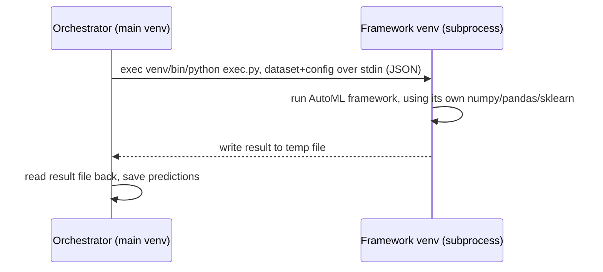

# Architecture overview

## The isolation mechanism

Every AutoML framework runs in its own `uv`-managed Python venv, under
`frameworks/<Name>/venv/`. The orchestrator never imports a framework's
code directly — instead:

1. `frameworks/<Name>/__init__.py::run()` calls
   `frameworks.shared.caller.run_in_venv()`.
2. `run_in_venv()` execs `frameworks/<Name>/venv/bin/python
   frameworks/<Name>/exec.py` as a subprocess, with the dataset and
   `TaskConfig` serialized to JSON and piped over stdin.
3. `exec.py` (running inside the framework's own venv, with that venv's
   own numpy/pandas/sklearn/etc.) calls `frameworks.shared.callee.call_run()`,
   which deserializes stdin, runs the framework, and writes a JSON result
   to a temp file.
4. `run_in_venv()` reads that result file back and returns it to the
   orchestrator process.

This is why two frameworks with mutually-incompatible dependency pins
(e.g. NaiveAutoML's `numpy<2` vs. AutoGluon's numpy-2-era stack) can coexist
in the same CAML install without conflict — they never share a Python
process, only a JSON-over-stdin/file contract.

**This mechanism is ported ~verbatim from AMLB** (`frameworks/shared/caller.py`,
`callee.py`) — confirmed during planning that `run_in_venv()` has zero
opinion about *how* the venv was created, only where its `bin/python`
lives. Swapping AMLB's stdlib `venv` for `uv venv` at the same path required
no changes to this file beyond an import-path fix.

## What creates the venv: the installer

See [framework-plugin-contract.md](framework-plugin-contract.md) for the
full picture. In short: `src/caml/frameworks/installer.py` reads a
framework's `framework.toml` manifest and runs `uv python install`, `uv
venv`, then `uv pip install` — replacing AMLB's per-framework `setup.sh`.

## Why per-framework venvs, concretely

NaiveAutoML exact-pins `numpy<2`, `scikit-learn==1.5.2`, `configspace==1.2.0`
as of 2026-07-17 (verified against its PyPI metadata). AutoGluon 1.5.0 is
built against numpy 2.x. If both frameworks had to share one Python
environment, at least one would be uninstallable alongside the other. This
is the single clearest real-world justification, in the whole v1 roster,
for the isolation model CAML (and AMLB before it) uses.

## Config and resource resolution

`src/caml/resources.py` (`Resources`, singleton via `resources.get()`)
loads `resources/config.yaml` (defaults), merges in CLI-provided overrides,
and resolves:

- **Constraints** (`resources/constraints.yaml`): named runtime/hardware
  budgets (`test`, `1h4c`, ...), selected via `caml run <fw> <benchmark>
  <constraint>`.
- **Benchmark suites** (`resources/benchmarks/*.yaml`): lists of OpenML
  tasks (or user-defined datasets).
- **Framework definitions**: via `src/caml/frameworks/registry.py`
  (directory-based discovery of `frameworks/<Name>/framework.toml`) — this
  is the one part of `resources.py` that's a genuine rewrite rather than a
  port, since AMLB's equivalent (`framework_definition`/`_frameworks`) was
  backed by a central `resources/frameworks.yaml` catalogue CAML doesn't have.

## What was dropped, and why

- **Docker/Singularity/AWS runners** (`amlb/runners/{docker,singularity,aws,container}.py`):
  CAML targets a single Ubuntu VPS, not a cluster. AMLB's own container
  recipes already duplicated (and drifted from) its bare-metal `setup.sh`
  logic — dropping them removes an entire class of "the container build
  disagrees with the local install" bugs found during research (e.g. AMLB
  issue #690, FLAML Docker missing pandas despite a successful-looking build).
- **`resources/frameworks.yaml`**: replaced by directory-based discovery —
  see framework-plugin-contract.md.
- **Result upload / report plotting** (`amlb_report/`, `upload_results.py`):
  backlog, not v1 — see `STATUS.md` Phase 8.
